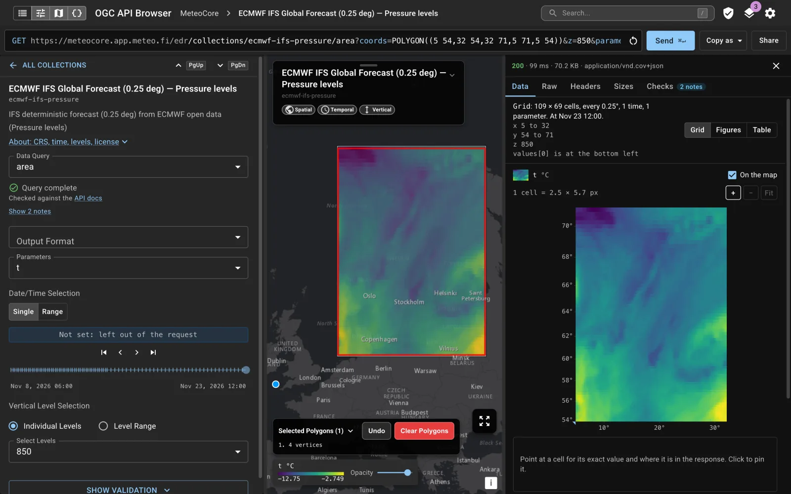
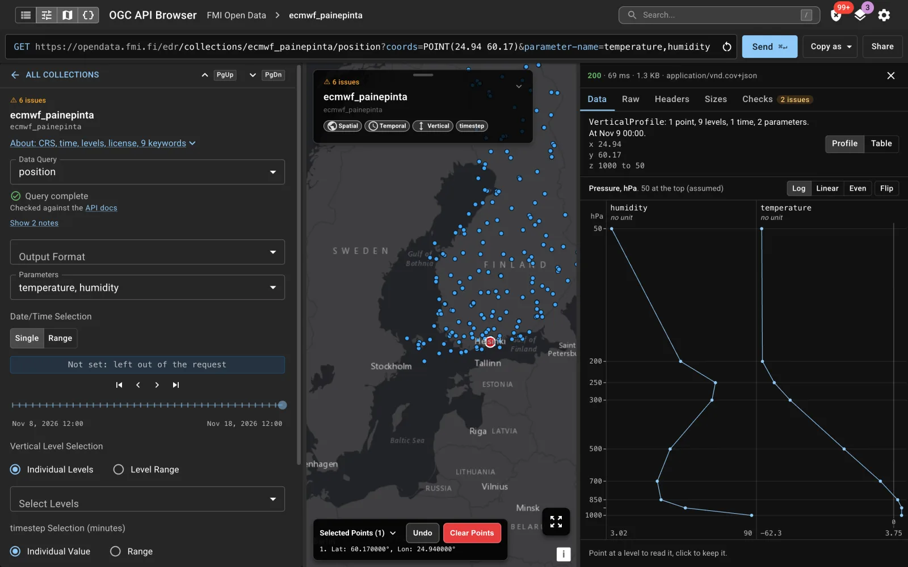
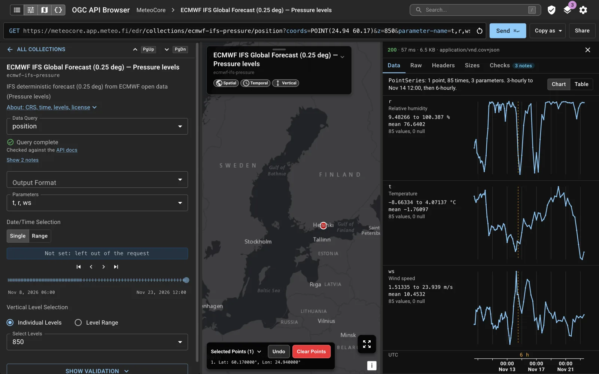
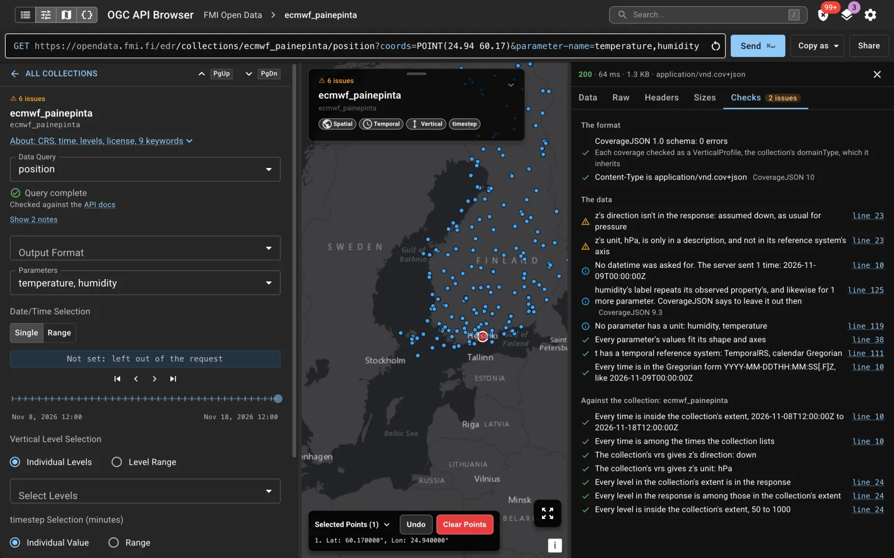

# OGC API Browser

A browser for OGC API services. Point it at an OGC API - EDR, Features, Maps, Records or STAC
endpoint to explore its collections on a map, build and run data queries, and see how well the
service follows the standards.

**Use it online:** https://ogcapi-browser.meteo.fi (also at https://mrauhala.github.io/ogcapi-browser/)



*An area query on MeteoCore: the temperature at 850 hPa, drawn on the map and in the Data tab. [Open it in the app](https://ogcapi-browser.meteo.fi/#request=https%3A%2F%2Fmeteocore.app.meteo.fi%2Fedr%2Fcollections%2Fecmwf-ifs-pressure%2Farea%3Fcoords%3DPOLYGON%28%285%2054%2C32%2054%2C32%2071%2C5%2071%2C5%2054%29%29%26z%3D850%26parameter-name%3Dt).*

## Features

- **Services:** 20 presets (EDR services such as FMI, DMI, DWD, Met Office, MeteoCore, Meteogate
  and SWIM; WMO WIS2 Global Discovery Catalogues; STAC catalogues; MSC GeoMet), or any URL. Services can
  use an API key, a bearer token, basic authentication or a custom header.
- **Map:** collection extents, location features, OGC API - Maps layers (map images or map tiles,
  with styles and time animation), fetched GeoJSON as layers, and a layer manager.
- **EDR query builder:** every query type (position, radius, area, cube, trajectory, corridor, items,
  locations, instances) with parameters, time, vertical levels, custom dimensions and output formats.
  Geometry is drawn on the map, and the request URL updates as you go. Edit the URL, bad values included,
  and what's in it is what's sent. The form and map follow what they can hold, and the app goes to
  another collection or API if the URL points there.
- **Links to a request:** share a link that reopens the request here, with its API, collection, form and
  map, or copy the request as a URL or a curl command. A link never sends anything by itself, and
  stored credentials stay out of both. A key typed into the URL by hand stays in it.
- **Validation as you build:** what the query still misses or gets wrong, checked against EDR, the
  collection's metadata and the server's OpenAPI definition. The service itself is validated
  against the OGC schemas (Common, Features, EDR 1.0–1.2, Records, Maps), and its OpenAPI document
  for structure and EDR consistency.
- **Responses:** read through Data, Raw, Headers, Sizes and Checks tabs, with a JSON viewer that
  steps through what Checks flags.
  - **CoverageJSON** as what it holds:
    - an area or cube as a picture of its cells, with a legend, a readout that pins a cell and
      opens its value in Raw, and a step bar for times and levels, also on the map;
    - levels at a point as profiles, a panel per parameter;
    - a time series as a chart per parameter;
    - a path (Trajectory or Section) as positions along it, with their distance.

    Figures sum up each parameter, a Table lists the values where there are several, and a
    response the app can't read says why rather than breaking.

    

    *Levels at a point on FMI Open Data, a profile per parameter. [Open it in the app](https://ogcapi-browser.meteo.fi/#request=https%3A%2F%2Fopendata.fmi.fi%2Fedr%2Fcollections%2Fecmwf_painepinta%2Fposition%3Fcoords%3DPOINT%2824.94%2060.17%29%26parameter-name%3Dtemperature%2Chumidity).*

    

    *A point over time on MeteoCore, a chart per parameter with its figures. [Open it in the app](https://ogcapi-browser.meteo.fi/#request=https%3A%2F%2Fmeteocore.app.meteo.fi%2Fedr%2Fcollections%2Fecmwf-ifs-pressure%2Fposition%3Fcoords%3DPOINT%2824.94%2060.17%29%26z%3D850%26parameter-name%3Dt%2Cr%2Cws).*
  - **IWXXM** rendered for reading, **images**, and **feature tables**. Features items can be
    filtered by their queryables.
- **Checks:** what's wrong with a response and what's right. Each finding is an error, an issue, a
  note or a pass, at its line in Raw. Many link to the section of the standard they rest on.
  - **The format:** the CoverageJSON 1.0 schema, each coverage as the domainType it inherits, or
    EDR's locations schema, and the media type.
  - **The data,** against CoverageJSON 1.0's rules:
    - values that fit their axes, and axes in order;
    - x, y and z referenced, with z's direction and unit;
    - a Trajectory's times in order, and every time in the right form;
    - units, labels and language tags.

    It also notes what's worth a look: likely fill values, uneven steps, a path ending short of
    its line, nulls.
  - **Against the request and the collection:** the datetime and levels asked for, and the
    collection's extent.
  - **Where two standards differ,** as EDR 1.2 and CoverageJSON do on UCUM's URI and the media
    type, it says so and cites both.

  

  *Checks for the same FMI profile: two issues with z, notes, and what passed, against the response and its collection. [Open it in the app](https://ogcapi-browser.meteo.fi/#request=https%3A%2F%2Fopendata.fmi.fi%2Fedr%2Fcollections%2Fecmwf_painepinta%2Fposition%3Fcoords%3DPOINT%2824.94%2060.17%29%26parameter-name%3Dtemperature%2Chumidity), then Checks.*
- **The API as loaded:** its landing page, conformance, OpenAPI document and collections, each with
  the response it came from.
- **Search:** a command palette (`/`) across collections and items.

## Running it

**Online:** https://ogcapi-browser.meteo.fi. Every merge to `main` deploys it.

**With npx**, no clone needed (requires Node.js):

```bash
npx ogcapi-browser              # http://localhost:3000
npx ogcapi-browser --port 8080
```

**With Docker:**

```bash
docker run --rm -p 8080:8080 ghcr.io/mrauhala/ogcapi-browser:latest   # http://localhost:8080
```

The image serves the app with nginx as a non-root user. To build it yourself:
`docker build -t ogcapi-browser .`. To serve it under a sub-path behind a proxy that strips the
prefix, add `--build-arg BASE_PATH=/ogcapi-browser/`.

## Local and private APIs

You don't need to run the app yourself to use an API on `localhost`, on your intranet or behind a
VPN. There is no backend: your browser sends every request straight to the API, so the online
version reaches any API your browser can. Credentials you enter are kept in your browser and sent
only to that API. npx and Docker serve the same static files and don't proxy anything.

The browser's own rules still apply:

- **CORS:** the API has to allow requests from other sites, with an `Access-Control-Allow-Origin`
  header (`*`, or the app's address). With authentication it also has to allow the header the
  credentials travel in (`Access-Control-Allow-Headers`). This holds wherever the app runs, since an
  app on `localhost:3000` is another site to the API too.
- **HTTPS:** the online version is served over HTTPS, and browsers block plain `http://` APIs from
  HTTPS pages, with two exceptions:
  - `http://localhost` and `http://127.0.0.1`, in Chrome, Edge and Firefox. Safari blocks them.
  - In Chrome, a private IP address such as `http://192.168.1.10`, or a `.local` name.

  For any other `http://` API, such as an intranet server by name, run the app with npx or Docker:
  served from `http://localhost`, it can call `http://` APIs.
- **Local network permission:** Chrome asks the first time the page connects to `localhost` or a
  private address. Allow it; if you blocked it, change it from the icon left of the address bar.

## Basemap

The dark basemap is Esri's Dark Gray Canvas, which needs no key. With a Carto API key the app uses
Carto's `dark_all` instead:

- **Development:** `VITE_CARTO_API_KEY=…` in `.env.local` (git-ignored). Restart the dev server after
  changing it. Carto won't add localhost to a key already restricted to published websites, so use a
  separate key for local development.
- **npx:** `npx ogcapi-browser --carto-api-key …`, or the `CARTO_API_KEY` environment variable. It
  applies at serve time, since the package ships a prebuilt app.

The key ends up in the browser, so it is public: restrict it to your sites in Carto.

## Keyboard shortcuts

| Key | Action |
|---|---|
| `PageDown` / `PageUp` | Next / previous collection, or scroll the API's list while it's showing |
| `Cmd+Enter` / `Ctrl+Enter` | Send the request |
| `Enter` in the request URL | Send it |
| `Esc` in the request URL | Undo your typing |
| `A` | The API's list, or back to the open collection |
| `B` | Toggle the Request pane |
| `M` | Toggle the Map pane |
| `R` | Toggle the Response pane |
| `S` | Toggle settings |
| `L` | Toggle layers |
| `V` | Toggle validation results |
| `I` | Toggle collection info |
| `/` | Search |
| `?` | Show keyboard shortcuts |
| Arrow keys, `+` / `-` | Pan and zoom the map (click the map first) |

Single-letter shortcuts don't fire while a text field has focus.

Inside the Response pane:

| Where | Key | Action |
|---|---|---|
| Raw | `Cmd+↑` / `Cmd+↓` (`Ctrl` elsewhere) | Previous / next flagged line |
| A picture of cells (click it first) | Arrow keys | Move the pinned cell |
| | `+` / `-`, `0` | Zoom in or out, fit it again |
| | `Esc` | Unpin |
| A profile | `↑` / `↓`, `←` / `→` | The level, the time |
| A step bar | `←` / `→`, `Home` / `End` | A step, the first or last |
| A pane divider | `←` / `→` | Resize the pane |

## Development

Requires Node.js 24 (see `.node-version`).

```bash
npm ci              # install dependencies
npm run dev         # dev server at http://localhost:3000
npm test            # unit tests (Vitest)
npm run lint        # ESLint
npm run build       # production build to build/
npm run preview     # serve the production build
npm run schemas     # regenerate the bundled OGC and OpenAPI schemas
```

The app is React, TypeScript and Vite, with MUI for the interface and OpenLayers for the map.

| Path | Contents |
|---|---|
| `src/query/` | the data query model: building request URLs and validating queries |
| `src/coverage/` | reading CoverageJSON responses (cells, profiles, paths) and checking them |
| `src/standards.ts` | the sections of the standards that findings cite |
| `src/overview/` | the API's resources as loaded |
| `src/validation/` | service and OpenAPI document validation |
| `src/api/` | fetching from OGC API services |
| `src/contexts/` | shared app state |
| `public/schemas/` | the bundled JSON Schemas ([docs/schemas.md](docs/schemas.md)) |
| `scripts/` | the schema download script |

More: [releasing](docs/releasing.md), [bundled schemas](docs/schemas.md),
[CI and deployment workflows](.github/workflows/README.md).

## License

Licensed under either of

- Apache License, Version 2.0 ([LICENSE-APACHE](LICENSE-APACHE) or <https://www.apache.org/licenses/LICENSE-2.0>)
- MIT license ([LICENSE-MIT](LICENSE-MIT) or <https://opensource.org/licenses/MIT>)

at your option.

Unless you explicitly state otherwise, any contribution intentionally submitted for inclusion in the work by you, as defined in the Apache-2.0 license, shall be dual licensed as above, without any additional terms or conditions.
